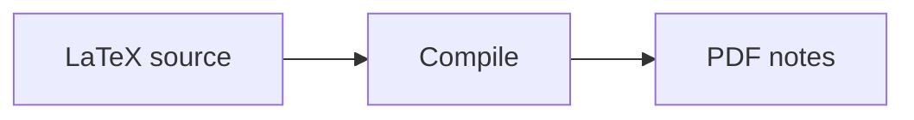

# Contributing

Thank you for helping maintain the Westlake Noter website.
Contributions here can improve the course index, fix links, and add tools.
Application, theme, synchronization, tests, and deployment changes belong in
[westlake-drawer.github.io](https://github.com/westlake-drawer/westlake-drawer.github.io).

This repository owns `docs/`, `content/`, and `static/`. All `npm` commands and
engine code paths mentioned below refer to the separate application checkout,
not this content repository. Use `NOTES_CONTENT_DIR` when previewing local edits.

For the configuration contract, see [Content Configuration Reference](CONTENT_API.md):
directory segments, frontmatter fields, category metadata, tab schemas,
URL parameters, rendering boundaries, and common errors. This guide explains
the contribution workflow; the reference explains what each setting means.

## Scope

- Put course descriptions, repository links, and reading instructions in the
  website's course pages, not in the project README.
- Keep website text, page titles, and navigation labels in English.
- Link to original course repositories instead of copying their contents here.
  Submit corrections to the lecture notes in the relevant source repository.
- Include only public course materials. Do not publish private repositories,
  credentials, or member information.
- Preserve existing page URLs when reorganizing files. Use an explicit `slug`
  when needed, and update any affected internal links.

## Development Setup

Create a branch for your changes; fork this content repository first if you do
not have write access. Editing content alone needs no dependency installation.
For preview and validation, use Node.js 22 in a separate application checkout:

```sh
git clone https://github.com/westlake-drawer/westlake-drawer.github.io.git ../westlake-drawer.github.io
cd ../westlake-drawer.github.io
npm ci
export NOTES_CONTENT_DIR=../notes-index
npm start
```

Open `http://localhost:3000/`. Keep `NOTES_CONTENT_DIR` set when running the
other `npm` commands in this guide. Normal application commands without that
override use its own ignored `.content-source/` checkout.

## Repository Layout

```text
content/
  repository-tabs/
    <subject>/
      <course>/
        <term>/
          <note-set>/
            <custom-tab>.md
            <original-filename>.toc
docs/
  notes/
    index.md
    <subject>/
      _category_.json
      index.md
      <course>/
        _category_.json
        <term>/
          _category_.json
          <note-set>/
            index.md
  tools/
    index.md
static/img/
  campus-light.webp
  campus-dark.webp
```

The application's `sidebars.js` discovers content root sections automatically.
You do not need to register sections or individual pages there.

### Code Boundaries

The following modules live in the **application repository**, not here. For
application changes, see its
[engine contribution guide](https://github.com/westlake-drawer/westlake-drawer.github.io/blob/main/CONTRIBUTING.md).

- `src/features/navigation/`: navbar links, expansion controls, scroll state,
  and the browser lifecycle hook. Pure scroll rules live in `scroll-state.mjs`.
- `src/features/toc/`: heading visibility, following highlight, and TOC rendering.
- `src/features/repositories/`: document repository information and the homepage
  contributor section, sharing `ContributorAvatars` and one CSS module.
- `src/theme/`: Docusaurus adapters and document/sidebar placement. Keep feature
  behavior in `features/`, not in theme registration files.
  `DocCardList` applies shared directory-card styling to both `AutoDocIndex`
  and generated course/term listings. `DocCategoryGeneratedIndexPage` reuses
  document typography; do not add separate card designs for deeper categories.
- `src/components/`: standalone reusable visuals such as icons and the campus map.
- `src/css/`: shared typography, color tokens, and Glass layout selectors;
  feature-specific styles stay beside their components.
- `lib/github/`: repository URL extraction, GitHub endpoint clients,
  sanitized document rendering, and snapshot freshness/concurrency rules.
- `lib/local-repository-tabs.mjs`: local custom-tab source discovery.
- `lib/course-outline.mjs`: structured course-outline validation and heading IDs.
- `plugins/`: remark adapters that attach repository metadata and custom tabs.
- `scripts/`: command-line entry points. Keep reusable sync rules in
  `lib/github/sync.mjs`, not in the script.
- `src/data/`: committed, public repository snapshots; these are generated
  data, not hand-authored course descriptions.

Import feature entry points from pages and theme adapters. Do not import a
theme adapter from a feature; use native `@theme-original` components when
wrapping Docusaurus, or native primitives such as `@theme/TOCItems`. Keep pure
rules independent of React so `npm test` can cover them directly.

The homepage lives at `/`; the course directory lives at `/notes/`. Edit
`src/pages/index.js` and its CSS module for the homepage skeleton. The campus
map uses `src/components/CampusMap` with Docusaurus `ThemedComponent` to follow
the selected theme. It shows a skeleton until the selected image is loaded and
decoded, and leaves a static placeholder if loading fails. When replacing
the maps, retain their attribution and keep both theme variants at matching
dimensions. The current WebP assets were converted from the user-supplied
3543 x 1476 PNG exports at quality 90 without resizing.

## Add or Update a Course

Create one introduction per note set at
`docs/notes/<subject>/<course>/<term>/<note-set>/index.md`.
Use the same subject, course, term, and note-set slugs as its files in
`content/repository-tabs/`. Multiple years and sources belong under the same
course directory, not in a single growing introduction.

For example, the Quantum Mechanics introduction and its local TOC live at:

```text
docs/notes/physics/quantum-mechanics/2025-fall/jietexue/index.md
content/repository-tabs/physics/quantum-mechanics/2025-fall/jietexue/quantum-mechanics-notes.toc
```

Use the verified teaching term, or `undated` when unknown. A PDF release update
does not create a new teaching term. Different independent sets by the same
author need distinct note-set slugs; see **Content Organization** below.

```md
---
title: New Course
description: A short summary of the course materials.
sidebar_label: Author
---

# New Course

Briefly describe the materials and their scope.

- Repository: [Repository name](https://github.com/OWNER/REPOSITORY)
- Contents: topics or chapters covered.
- Reading: where to find PDFs, releases, or build instructions.
```

Replace the example title, links, and content with verified information.
Do not claim that PDFs or releases exist without checking.
Use `description` for the directory card summary and `sidebar_label` for the
note-set's author or source. Keep the course title in `title` and the article's
heading; the enclosing course and term categories supply navigation context.

When adding a new course, optionally add `_category_.json` for its visible name
and description (otherwise the directory name is used):

```json
{
  "label": "New Course",
  "description": "New Course notes, organized by teaching term and source."
}
```

Use `_category_.json` in a new term directory when its label needs formatting:

```json
{
  "label": "Fall 2026"
}
```

Replace the labels with the real course and term. Reuse existing
category files when adding another note set to a course or term.
Do not add `position` or `sidebar_position`: Notes and Tools navigation is ordered
automatically by aggregate repository statistics, not manual positions.

Docusaurus generates the course and term listing pages from these categories.
An author/source directory containing only `index.md` becomes a direct link,
not another empty category. No React page, manual course list, or `sidebars.js`
entry is needed.

New note-set pages use their nested file paths as URLs by default. Existing
introductions have explicit `slug` values preserving their published short
URLs, including tab queries and heading fragments. Keep those slugs unchanged;
do not copy an existing page's slug into a new note set. Existing course listing
pages have explicit `/notes/<subject>/<course>/editions` links to avoid their
legacy introduction URLs. New courses need no explicit category link unless
you intentionally override the generated path.

### Automatic Directory Ordering

All discovered sections and their nested sibling lists are sorted by:

1. Total Stars, descending.
2. Total Forks, descending.
3. Total open issues, descending.
4. Visible English name, ascending, case-insensitively.

Each level totals the unique repositories linked by its descendant
introductions, including a category's linked introduction if it has one.
The same repository appearing in multiple years or sources counts once
within their common parent, not once per file or child directory.
Distinct repositories add together. Missing or invalid counts contribute zero.
Identical names use stable document IDs or category routes as a final tie-break.
Each section's root overview remains the first link in its own sidebar.
The top navbar lists sections alphabetically by their visible labels.

The sidebar, directory cards, and previous/next navigation share this order.
TOC volume order and custom tab order still follow their declaration lists;
they are not directory entries.

Statistics come from `src/data/repository-contributors.json`, not live browser
requests. `openIssues` uses GitHub's `open_issues_count`, which includes open
pull requests as well as open issues; it is not a count of all historical issues.
Old snapshots without this field refresh on the next repository sync.
Run `npm run sync:repositories`, then restart `npm start` or run
`npm run build` to recompute the order. CI syncs before building.
The existing six-hour freshness cache still applies once snapshots are complete.
Use `--force` to refresh complete snapshots sooner.

### Sections and Categories

Every section uses the same navigation generator, recursive ranking, and native
Docusaurus directory pages. Notes uses subject/course/term/source directories;
Tools uses category/tool directories, for example
`docs/tools/ai-tools/plugin/<tool>/index.md`. The engine does not hardcode either
hierarchy.

For a new top-level section, create these files:

```text
docs/research/
  _category_.json
  index.md
  software/
    _category_.json
    example.md
```

`docs/research/_category_.json` supplies the navbar label:

```json
{"label": "Research"}
```

`docs/research/index.md` is the root entry:

```md
---
title: Research
slug: /research
---

# Research

<AutoDocIndex />
```

The new section appears automatically in the navbar, footer, and its own sidebar
after restarting development or building. No edits to `sidebars.js` or
`docusaurus.config.js` are needed. Root directories need an `index.md` or
`index.mdx`; directories prefixed with `_` or `.` are not section entries.
Labels fall back to a human-readable directory name without `_category_.json`.

For nested categories, add content files and optionally
`_category_.json` containing a label and description. Do not create an index
Markdown file just to list children: directory pages are generated automatically
at `/<section>/<nested-directory>`. Intermediate directories work at any depth.
An empty directory or metadata-only directory remains hidden until it contains
a document. To reserve a genuinely empty section, write a placeholder document.

An authored `index.md` is supported at any depth for real introductory content;
it replaces that category's generated page using native Docusaurus conventions.
`<AutoDocIndex />` lists that category's children and excludes itself. Explicit
category links remain supported, including existing `/editions` routes, so old
published URLs are not broken. These are generic content overrides, not
Tools-specific handling.

The existing AI Tools and Plugins categories group tool introductions; they do
not imply an independent review of each tool. Add verified repository
links in each real tool's introduction. They are discovered by the same sync
command and count toward parent totals. Categories with no repository links
have zero metrics and sort by their visible names.

## Repository Contributors

GitHub repository links in Markdown automatically add repository information
and contributors to the right-hand rail, below the table of contents when one
exists. On mobile they appear after the article. Repository, file, and release
links for the same repository are deduplicated. Bare URLs, reference links, and
static MDX `<a href="...">` links work too; code examples and GitHub profile links
do not create contributor sections.

The homepage displays a deduplicated preview of contributors across the linked
repositories. The display uses GitHub's commit-based contributor list, not a
complete list of authors, reviewers, or people who helped outside GitHub.
Repository links follow Fumadocs's compact GitHub Info presentation, including
stars and forks when available. Statistics and contributor lists are snapshots,
not live counters.

Pages builds run `npm run sync:repositories` using the workflow's read-only token
before building. Local `npm run build` and `npm start` use saved snapshots in
`src/data/repository-contributors.json` and `src/data/repository-documents.json`
and do not need network access to GitHub's API.
To refresh it locally, run:

```sh
npm run sync:repositories
npm test
npm run build
```

An optional `GITHUB_TOKEN` environment variable raises the API rate limit.
Never commit a token. Failed requests retain the previous snapshot; new
repositories without data show a link to GitHub's contributors page instead.
Changes on external repositories become visible after the next sync and site
deployment; they do not update live in the visitor's browser.

The sync command reuses complete snapshots for up to six hours. It checks
contributors, statistics, README, Contributing, and License together; a new
repository, an incomplete snapshot, or a failed previous fetch is retried.
Two repositories refresh concurrently, with independent endpoint families
requested in parallel. Removed repository links are pruned from the output.
Transient errors preserve saved data rather than publishing blank content.

To fetch upstream changes immediately, bypassing the freshness window:

```sh
GITHUB_TOKEN="$(gh auth token)" npm run sync:repositories -- --force
```

This uses your existing GitHub CLI login. Without `gh`, set `GITHUB_TOKEN`
through your local environment instead; never put tokens in committed files.
The ignored `.cache/repositories/` directory stores reusable local/CI
snapshots. The command merges it with committed data by timestamp and writes
the selected results to the application's `src/data/`. Keep intentional snapshot
commits in the application repository, never this content repository. Ordinary
content contributions do not need snapshot commits: publication sync handles
new linked repositories. Regular local builds do not contact the GitHub API.

### Repository Documents

Pages linking to repositories have four tabs: Overview, README, Contributing,
and License. Overview remains the default and
contains our curated course introduction. README displays the upstream document
without duplicating it in the Overview. Keep detailed build steps and file
listings upstream; keep the course summary and reading guidance in the Overview.

The README tab includes its original path, source link, and actual last sync
date. For pages linking to multiple repositories, a select control chooses the
document. All tabs share repository statistics and contributors; desktop and
mobile tables of contents follow the selected content. `?view=readme&repo=owner/name`
(or `view=contributing` / `view=license`) and scoped heading fragments preserve
the selected document after refreshing.

`lib/github/documents.mjs` fetches the default README through GitHub's REST API,
renders GFM and KaTeX with unified, and caches sanitized HTML and its heading
tree. Relative links point to GitHub files and relative images to raw files.
README HTML is sanitized before trusted KaTeX output is added; it is never
compiled as MDX or executed as JavaScript. Some embedded widgets and custom
HTML are deliberately removed. Images still load from their original hosts.

Contributing and License display separate upstream files, discovered at the
repository root or under `.github/` or `docs/`, with case-insensitive filenames.
Root files take precedence. README's existing contribution/license sections
remain untouched; they are never extracted into the other tabs. Missing
independent files get their own empty state. Each document has its own cache,
sync timestamp, source link, and scoped heading IDs.

### Custom Document Tabs

Use custom tabs for locally maintained material such as a detailed course
outline, reading guide, or exercises. Overview is the main course Markdown;
README, Contributing, and License come from the linked upstream repository.
Do not edit the generated snapshots to add local content.

All paths below are relative to this repository's root.

#### Content Organization

Organize tab files by subject, course, term, and note set:
`content/repository-tabs/<subject>/<course>/<term>/<note-set>/`.
The full directory path mirrors the introduction at
`docs/notes/<subject>/<course>/<term>/<note-set>/index.md`. Keep one course
category as the entry point for all years and contributors, with separate
introductions for independent note sets. For example:

```text
content/repository-tabs/
  math/
    fundamental-algebra-analysis/
      2025-fall-2026-spring/
        westlake-noter/
          volume-i.md
          volume-ii.md
  physics/
    quantum-mechanics/
      2025-fall/
        jietexue/
          quantum-mechanics-notes.toc
          exercises.md
      2026-fall/
        another-author/
          quantum-mechanics-notes.toc
```

The example exercises and 2026 notes illustrate future additions.
Use the course's teaching term, not the upload date or PDF release version.
Use lowercase slugs such as `2025-fall` or `2025-fall-2026-spring`; use `undated`
when the teaching term is unknown rather than inventing a year.
The note-set slug identifies the author, organization, or source repository,
for example `jietexue` or `westlake-noter`. If one author maintains multiple
independent sets in the same term, give them distinct descriptive slugs,
such as `jietexue-lecture-notes` and `jietexue-study-guide`.
PDF release updates replace files within the same note set; a new teaching
term or independent set gets a separate directory.

Use short descriptive filenames for Markdown tabs and keep compiled `.toc`
filenames unchanged. For multiple PDFs with identical output filenames, use
volume subdirectories such as `volume-i/notes.toc` and `volume-ii/notes.toc`.
All subdirectories are loaded recursively; no directory registration is needed.
Keep files for new courses out of the top-level `repository-tabs/` directory.
Existing flat paths remain supported.

Folders only organize source files: they do not create tabs, routes, or sidebar
entries. Declare each tab explicitly in the course page's `repositoryTabs`.
Moving a file only requires updating its `file` reference and any source-file
links in documentation; keeping tab/document IDs and headings unchanged
preserves the site's existing tab URLs and heading anchors.

#### Adding a Tab

1. Create the tab's content file, for example
   `content/repository-tabs/physics/new-course/2026-fall/author/exercises.md`:

   ```md
   # Exercises

   ## Chapter 1

   Practice problems and references for this chapter.

   ## Chapter 2

   Additional exercises.
   ```

2. Open the corresponding note-set introduction at
   `docs/notes/<subject>/<course>/<term>/<note-set>/index.md`.
   Add `repositoryTabs` inside its existing YAML frontmatter (the block between
   the first pair of `---` lines), not in the article body. Keep the page's
   existing title, sidebar settings, repository link, and other content.
   A complete minimal note-set page looks like this:

   ```md
   ---
   title: New Course
   description: Course notes and exercises.
   sidebar_label: Author
   repositoryTabs:
     - id: exercises
       label: Exercises
       file: content/repository-tabs/physics/new-course/2026-fall/author/exercises.md
   ---

   # New Course

   A short course introduction.

   - Repository: [Course notes](https://github.com/OWNER/REPOSITORY)
   ```

3. To add more tabs, append entries to the same `repositoryTabs` list.
   Each entry needs an `id`, `label`, and `file`:

   ```yaml
   repositoryTabs:
     - id: exercises
       label: Exercises
       file: content/repository-tabs/physics/new-course/2026-fall/author/exercises.md
     - id: reading-guide
       label: Reading Guide
       file: content/repository-tabs/physics/new-course/2026-fall/author/reading-guide.md
   ```

   Create every referenced file before building. `id` is the URL identifier
   (for example, `?view=exercises`); `label` is the visible English tab name;
   `file` is the exact, case-sensitive path from the repository root, not a
   path relative to the course page.

   For LaTeX course contents, upload the compiled `.toc` file directly instead
   of rewriting it as Markdown or JSON; see **LaTeX Course Outlines** below. The file
   extension selects the renderer. Do not add a `layout` setting.

4. Run `npm start` to preview the course page and select the new tab.
   If the server is already running, stop and restart it after changing
   local tab files or their declarations. Check that the content, right-hand
   table of contents, and a refresh with `?view=exercises` all work.
   Also check a narrow mobile viewport.

5. Before submitting a pull request, run:

   ```sh
   npm test
   npm run build
   git diff --check
   ```

   Include both the course page configuration and its new content files in
   the pull request. No changes to React, `sidebars.js`, or `src/data/` snapshots
   are needed; local tabs do not require `npm run sync:repositories`.

The custom tab with `id: toc` appears immediately after Overview, before README.
It supports ordinary `.md` files as well as compiled `.toc` files.
Other custom tabs append after the four built-in tabs, in declaration order.
Reorder the list to reorder those custom tabs. IDs must start with a lowercase letter, contain
only lowercase letters, numbers, and hyphens, and be unique within the page.
Do not use the reserved IDs `overview`, `readme`, `contributing`, or `license`.
Keep IDs stable after publishing so existing links continue to work.
The course page must link to at least one GitHub repository.

Use `.md`, `.toc`, or legacy `.toc.json` files under `content/repository-tabs/`; these are tab content, not
standalone routes or sidebar pages. Use ordinary Markdown, GFM tables, and
KaTeX math, not MDX imports, React components, or interactive Mermaid blocks.
HTML is sanitized and JavaScript is not executed.
Local Markdown shares the sanitized GFM/KaTeX renderer and dynamic TOC. Its
headings have scoped anchors, and `?view=reading-guide` survives refresh.
Use site-root links such as `/notes/math/` and `/img/example.png`; the renderer
adds the deployed `baseUrl`. Full external URLs remain unchanged. Custom
documents have a source link to this site's repository and no GitHub sync date.
Their content is shared across the page's repositories, not fetched per repo.

`plugins/remark-repository-tabs.mjs` embeds the documents at build time.
`loadLocalTabSources()` includes source text in remark options so production
MDX caches invalidate when the files change. Restart `npm start` after creating
or changing these local tab files, since their sources are loaded with the site
configuration. `npm run build` always picks up the latest local files.

### LaTeX Course Outlines

Compile the original LaTeX document with its table of contents enabled
(`\tableofcontents`). Copy the resulting nonempty `.toc` file from the build
directory into `content/repository-tabs/<subject>/<course>/<term>/<note-set>/`, without editing
its contents.
Overleaf users can download it from the project's output files.
Keep it as UTF-8. Filenames only need to be unique within their directory.

Point the note-set introduction's frontmatter at that file:

```yaml
repositoryTabs:
  - id: toc
    label: TOC
    file: content/repository-tabs/physics/new-course/2026-fall/author/new-course.toc
```

An optional `source` adds a separate PDF link:

```yaml
repositoryTabs:
  - id: toc
    label: TOC
    file: content/repository-tabs/physics/new-course/2026-fall/author/new-course.toc
    source:
      label: PDF
      url: https://example.com/notes.pdf
```

Replace the example URL with the actual HTTPS PDF URL. The parser reads
standard `\contentsline` records with three arguments (without hyperref) or four
(with hyperref), including multiline records. It derives the hierarchy from
`part`, `chapter`, `section`, `subsection`, `subsubsection`, `paragraph`, and
`subparagraph`. Both numbered and unnumbered headings work. It preserves the
original `\numberline` labels and printed page labels, including appendix
numbers and Roman numerals. The web outline uses indentation, dotted leaders,
and right-aligned page labels; it never renumbers entries or computes pages.
Unnumbered headings stay unnumbered, and empty page labels stay empty.
No manual numbering, JSON conversion, or per-topic configuration is needed.
Page labels are not PDF links, since printed and physical PDF pages can differ.
The fourth hyperref argument is not used as a web anchor.

Nested braces, common font commands such as `{\small ...}` and `\textbf{...}`,
escaped characters such as `\&`, Unicode, and common TeX accents are supported.
Inline `$...$` and `\ensuremath{...}` math use KaTeX;
`\texorpdfstring{TeX version}{plain version}` uses the
plain version. Font commands are flattened to the site's typography: `.toc`
alone does not contain the document class, preamble, fonts, or full PDF layout.
This is a parser, not a TeX engine: no commands are executed and
no `\input` files or document preamble are loaded. Unknown commands inside
titles fail the build explicitly instead of silently dropping text. For a
custom macro, supply a plain short heading or `\texorpdfstring` alternative in
the original `.tex` and recompile. Do not hand-edit the generated `.toc`.

The build uses the `unified-latex` parser in `lib/latex-toc.mjs` and reuses
`CourseOutline` for layout and the right-hand chapter TOC. It does not run a
LaTeX compiler in CI. To update the site, replace the uploaded `.toc` with the
latest compiled copy and commit it. Changing a top-level title changes its
generated anchor, just as it does in Markdown.

See [Quantum Mechanics](docs/notes/physics/quantum-mechanics/2025-fall/jietexue/index.md) and
[its uploaded LaTeX outline](content/repository-tabs/physics/quantum-mechanics/2025-fall/jietexue/quantum-mechanics-notes.toc).
Restart `npm start` after replacing the file, then run `npm test` and
`npm run build`. If Git ignores `.toc` files globally, use `git add -f` for
this uploaded copy only. Empty or malformed files report `Invalid LaTeX TOC`.
Existing prose-based tabs can continue to use `.md`.

Legacy `.toc.json` files remain supported for courses without a LaTeX source.
Their shape is `{"title":"Table of Contents","entries":["Topic",{"title":"Parent","children":["Child"]}]}`.
Do not transcribe a compiled `.toc` into this format.

### Multiple Documents in One TOC Tab

For one PDF, keep the simple `file` and optional `source` configuration above.
For two or more PDFs, use a `documents` list instead of the tab-level `file`.
Each item has its own stable `id`, visible `label`, content `file`, and optional
PDF `source`. Formats can be mixed:

```yaml
repositoryTabs:
  - id: toc
    label: TOC
    documents:
      - id: volume-i
        label: Volume I
        file: content/repository-tabs/math/new-course/2026-fall/author/volume-i.toc
        source:
          label: Volume I PDF
          url: https://example.com/course-i.pdf
      - id: volume-ii
        label: Volume II
        file: content/repository-tabs/math/new-course/2026-fall/author/volume-ii.md
        source:
          label: Volume II PDF
          url: https://example.com/course-ii.pdf
```

Replace the filenames and URLs with real files and PDF links. Markdown stays
free-form; LaTeX files retain their specialized outline rendering. Both support
a separate PDF source link. These declarations are local to a course page:
a single repository can have multiple documents, and the TOC is not limited to
one document per repository.

There is still only one top-level TOC tab. A **Document** selector appears
inside it when there is more than one item. It updates the content, PDF link,
source-file link, and right-hand TOC together. A group containing one item
works without a selector. The first item is the default; reorder the list to
change the default. Do not combine `documents` with a tab-level `file` or
`source`. Nested document groups are not supported.

URLs such as `?view=toc&document=volume-ii` restore the selected volume on
refresh and can be shared. Each volume has separate heading anchors, so
identical headings in different PDFs do not collide. Keep tab and document
IDs stable after publishing. Converting a single file into a document group
changes its heading anchors; update existing links when migrating.
This grouping also works for custom tabs other than TOC.

Working example:
[Fundamental Algebra and Analysis](docs/notes/math/fundamental-algebra-analysis/2025-fall-2026-spring/westlake-noter/index.md)
declares one **TOC** tab with separate
[Volume I](content/repository-tabs/math/fundamental-algebra-analysis/2025-fall-2026-spring/westlake-noter/volume-i.md) and
[Volume II](content/repository-tabs/math/fundamental-algebra-analysis/2025-fall-2026-spring/westlake-noter/volume-ii.md)
Markdown documents. Overview keeps the course introduction.

### Multiple Years and Note Sets

For each independent year/source, create its own
`docs/notes/<subject>/<course>/<term>/<note-set>/index.md` and corresponding
content directory. Keep that set's introduction, repository links, custom tabs,
and PDF sources on its own page. README, Contributing, License, and contributors
are then discovered from the repositories linked on that page, without mixing
different years' sources.

Within one note set, use the TOC `documents` list for multiple volumes or PDFs.
When an intentionally curated comparison page needs documents from several
years or sources, the same list can reference files across directories:

```yaml
repositoryTabs:
  - id: toc
    label: TOC
    documents:
      - id: fall-2025-jietexue
        label: Fall 2025 / Jiete Xue
        file: content/repository-tabs/physics/quantum-mechanics/2025-fall/jietexue/quantum-mechanics-notes.toc
      - id: fall-2026-another-author
        label: Fall 2026 / Another Author
        file: content/repository-tabs/physics/quantum-mechanics/2026-fall/another-author/quantum-mechanics-notes.toc
```

This is an example, not a declaration of existing 2026 notes. Create the actual
files and use real authors before adding their entries. Add each PDF's optional
`source` as shown above. Give every document a unique ID within the tab; for
new entries include term, note set, and volume when relevant. Labels should
distinguish those same details in English. Existing published IDs such as
`volume-i` should stay unchanged even when their labels or file paths change.
The first entry remains the default; order entries deliberately.

The current Document selector is a single list, not nested year/author menus.
Local custom documents are shared across their introduction page and selected by
`document`; the upstream repository selector controls fetched GitHub documents
separately. Directory names do not automatically associate a TOC with a
repository or filter it. Include the source in the label and PDF link to make
that relationship clear.

If the build reports `Invalid repositoryTabs`, check for a reserved or
duplicate ID, an empty label, or a missing content file. If it reports
`repositoryTabs requires a page linking to a GitHub repository`, add a real
repository link to the course page. If the preview still shows old content,
restart `npm start`; changing tab sources does not hot-reload them.

On a transient fetch failure, keep the saved README and its original sync time,
marked as a cached copy. A confirmed missing README gets an explicit empty
state; unsynced repositories link to GitHub instead. `npm run sync:contributors`
remains an alias for the combined sync command.

## Add a Subject

Create `docs/notes/<subject>/` with `_category_.json`, an `index.md`, and its
course pages. Category metadata sets the display name; repository totals
determine Notes ordering:

```json
{
  "label": "Physics"
}
```

The subject directory page is generated automatically. An optional `description`
in its category JSON supplies an introduction. Only add an authored index when
you need more than the native directory page:

```md
---
title: Physics
slug: /notes/physics
---

# Physics

A brief introduction to this subject's materials.

<AutoDocIndex />
```

The Course Notes root uses `<AutoDocIndex />` to discover subject categories.
There is no separate home-page list to maintain.

## Tools and MDX

Tools uses the same automatically generated sidebar and nested directory pages
as every other section. Add tool introductions beneath the appropriate category
in `docs/tools/`; no listing Markdown or navigation registration is required.

Use `.mdx` for interactive pages. Keep reusable React components in
`src/components/` and import them into the page:

```mdx
import MyTool from '@site/src/components/MyTool';

<MyTool />
```

The component must exist at the imported path. Browser APIs such as `window`
and `document` must not be accessed during server rendering. Access them from
effects or event handlers, or render browser-only components through
`@docusaurus/BrowserOnly`.

`Tabs` and `TabItem` are globally available without imports:

```mdx
<Tabs>
  <TabItem value="source" label="Source" default>
    LaTeX source files.
  </TabItem>
  <TabItem value="pdf" label="PDF">
    Compiled lecture notes.
  </TabItem>
</Tabs>
```

## Icons and Motion

Navigation, directory cards, and the theme toggle use Lucide-based icons from
the MIT-licensed [AnimateIcons](https://github.com/Avijit07x/animateicons)
React package. Import individual icons rather than the complete icon collection.
`src/components/AnimatedIcon/` connects them to their parent link or button for
hover, keyboard-focus, and click feedback without changing navigation behavior.

Keep animations short and interaction-triggered, and respect
`prefers-reduced-motion`. Test keyboard access, mobile menus, both color modes,
and reduced-motion mode when changing animated controls. The navigation logo
uses the supplied Westlake SVG with its original colors.

## Layout and Upstream Styles

`src/css/glass.css` adapts Fumadocs Glass color tokens and layout utilities to
Docusaurus. The upstream source paths, pinned commit, and MIT license are
recorded in [THIRD_PARTY_NOTICES.md](THIRD_PARTY_NOTICES.md). Preserve that
attribution when changing derived styles.

Use the existing Docusaurus components for routing, navigation, and the mobile
drawer. The desktop sidebar wrapper only adds the shared `Logo` component.
Keep the logo transparent, preserve the two-state theme toggle, and check
sidebar scrolling and mobile navigation after layout changes.

The desktop `src/features/toc/` reuses Docusaurus's heading tree and Fumadocs's
multi-anchor observer and block highlight algorithm. All headings visible below
the navbar are highlighted together; when none are visible, the nearest heading
remains active. The desktop single-item Docusaurus highlight is disabled so it
cannot overwrite this range. Preserve the edge fade, keyboard focus,
reduced-motion behavior, and observer cleanup when editing it. The gray
surfaces use blue highlights with restrained orange accents drawn from the
supplied Westlake logo; keep orange text contrast-adjusted in both color modes.

`src/theme/Navbar/Layout/` wraps the original layout without replacing navigation
or the mobile drawer. Away from the page top, scrolling in either direction
contracts the surface toward the right actions. The expand button opens it
until the next actual page scroll; returning to the top opens it automatically.
Within 160px of the top, an already expanded navbar stays open while scrolling
upward, avoiding a collapse/expand flash. Downward scrolling still contracts it,
and this buffer never opens an already compact navbar.
The button uses Docusaurus's custom navbar item API. Scroll state is tested in
`tests/navbar-scroll.test.mjs`; no scroll-direction dependency is needed.
The implementation lives in `src/features/navigation/`; theme files only connect
the provider, links, and custom item to Docusaurus. The desktop GitHub action is
an icon-only 32px link with a tooltip and accessible name; the mobile drawer
retains its text label.
Only keyboard activation of the expand button moves focus to the first
navigation link. Pointer activation must not focus another link or trigger its
focus animation. Check both input methods after a fresh page load.
Keep hidden left-hand links inert, respect reduced motion, and test both sides
of the 997px desktop breakpoint when editing this behavior.

## Math and Diagrams

KaTeX supports inline math with `$...$` and display math with `$$...$$`:

```md
For $f(x) = x^2$, the derivative is $f'(x) = 2x$.

$$
\int_0^1 x^2\,dx = \frac{1}{3}
$$
```

KaTeX styles and fonts are bundled locally; an external CDN is not required.
The `katex` override in `package.json` keeps the math plugins and Mermaid on
the same patched version. When upgrading these dependencies, test both formulas
and diagrams.

Use a `mermaid` code block for diagrams:

````md

````

Mermaid colors follow the website's light/dark mode.

## Edit Links and Update Dates

Each page's **Edit this page** link points to its source file in this repository.
**Last updated** reflects that file's Git history, not activity in the linked
course repository. Newly added files need a commit before a real Git update
date can be inferred.

Development mode may show a simulated date. Production builds use the actual
commit date, and CI fetches the full Git history for this purpose.

## Checks Before a Pull Request

Run:

```sh
npm run build
git diff --check
```

The build checks internal document links. Also check external repository,
release, and PDF links manually.

- Confirm the page appears in the correct section and directory.
- Check desktop and narrow mobile layouts for wrapping and overflow.
- Check light and dark modes when changing styles, formulas, or diagrams.
- Test keyboard navigation and state changes for interactive components.
- Keep generated output, `node_modules/`, credentials, and temporary test pages
  out of the pull request.

## Submit Changes

Open a pull request against `main` with a short description of the change and
the checks you ran. Include screenshots for visible interface changes and
mention any changed URLs. Keep unrelated changes in separate pull requests.

Publishing is manual or daily, not triggered by pushes. Run
**Actions > Build and Deploy Pages > Run workflow** on `main` in
[the application repository](https://github.com/westlake-drawer/westlake-drawer.github.io/actions/workflows/pages.yml)
to publish sooner. It checks out this content repository's `main` branch.
The daily run starts at 19:23 UTC (03:23 the following day in UTC+8); GitHub may
delay scheduled jobs. It refreshes upstream repository data before checking
whether the published site needs to change.

Manual options:

- **Refresh upstream repository snapshots even when cached** fetches current
  contributors, statistics, README, Contributing, and License documents.
- **Rebuild and deploy even when site inputs are unchanged** bypasses the
  publication fingerprint check, for recovery or an intentional fresh build.

Application pull requests run tests and production builds but never publish;
root-Markdown-only application pull requests skip that check. This content
repository intentionally has no application/deployment workflow. Include local
preview checks with content pull requests. Manual application workflow runs on
branches other than `main` do not publish.

### Build and Deployment Performance

The site uses Docusaurus's official `@docusaurus/faster` package, pinned to the
same version as Docusaurus. `future.faster` enables SWC JavaScript compilation,
JavaScript/HTML minification, Lightning CSS minification, and shared MDX
compilation. Git metadata is read from the separate content
repository using the lazy strategy. Webpack remains the bundler; Rspack and SSG worker
threads are not enabled. Keep broken-link checks and the complete test suite.

CI maintains four separate caches:

- npm's download cache speeds up `npm ci --no-audit --no-fund`; dependencies
  are still installed from the lockfile on every run. The flags avoid install-time
  audit/funding requests, not dependency security maintenance.
- `node_modules/.cache/` preserves compilation caches after installation.
  Keys include runner platform, Node version, dependencies, and site configuration.
  Every successful publishing build saves a new cache, including daily builds on
  the same commit. Compatible runs restore the latest cache; a dependency or
  configuration change starts a new cold cache.
- `.cache/repositories/` preserves public upstream snapshots between runs.
  The six-hour freshness check avoids network requests during routine edits.
  Select **Refresh upstream repository snapshots even when cached** in a manual
  workflow run to force a refresh. Daily runs force refresh too. Successful
  synchronization saves fresh snapshots even when no publication is needed.
- `.cache/pages/published.json` stores source and effective-build fingerprints.
  It is saved only after a successful Pages deployment, never merely after a
  successful build. A failed or skipped deployment remains retryable.

An unchanged manual run skips dependency installation, synchronization, tests,
full-history fetching, compilation, artifact upload, and deployment. Full Git
history is fetched only before an actual build, for accurate last-updated dates.
Daily refreshes still install
dependencies, run tests, and synchronize upstream data. If only cache freshness
timestamps changed, compilation, upload, and deployment are skipped. Content,
repository counts, contributors, document status, and stale/error state still
participate in the effective fingerprint. Displayed sync dates therefore refer
to the last published snapshot, not every background freshness check.

Changes to root repository Markdown do not affect either fingerprint. Actual
site Markdown, local tabs/TOCs, navigation metadata, code, dependencies, config,
and assets do. Missing publication state causes a normal build rather than
guessing that a deployment exists.

This is compilation/data reuse, not partial HTML deployment. A real site change
still builds and checks the complete static site, reusing MDX and Webpack caches;
Markdown can affect navigation, links, and shared bundles. Generated `build/`
output is never restored as the published artifact. PRs never write shared
snapshots, compilation caches, or publication markers.

To measure a cold local build, run `npm run clear` followed by
`time npm run build`; then run `time npm run build` again for a warm comparison.
`npm run clear` also clears compilation caches. Do not compare cold and warm
times as if they were equivalent. GitHub's artifact upload, job scheduling,
and Pages publication remain outside the Docusaurus build.

New runs cancel older builds for the same branch or pull request. Deployments
remain serialized and are not interrupted by newer builds. Before publishing,
the deployment job checks that its commit is still the latest commit on `main`;
stale runs and manual runs on other branches do not publish.

If branch protection requires the build check, account for root-Markdown filters:
a skipped workflow does not report a successful required check.

For root-documentation-only changes, check the Markdown links and code blocks
and run `git diff --check`; a local site build is optional.

Maintainers configure **Settings > Pages > Source** as **GitHub Actions** in
`westlake-drawer.github.io`, not this content repository. The application's
`docusaurus.config.js` uses `baseUrl: '/'`; its `.github/workflows/pages.yml`
owns publication. Both engine and content revisions are checked before deploy.
